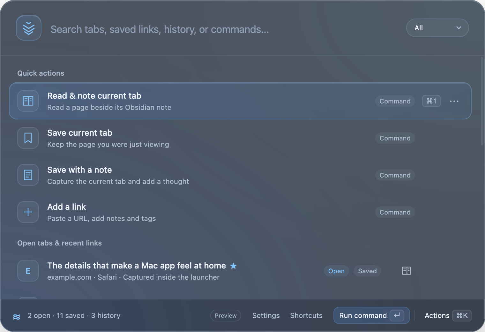

# Savenest for Mac

Save links. Keep the context. Find them again with **⌘O**.

Savenest is a free, open-source macOS launcher for saved links, notes, open browser tabs, and recent history. Your library stays on your Mac. Local features work without an account or subscription.

[Download preview](https://github.com/dmytro-omelian/savenest/releases/tag/v0.12.2) · [Website](https://savenest.app) · [Contribute](CONTRIBUTING.md) · [Report a bug](https://github.com/dmytro-omelian/savenest/issues/new?template=bug.yml)

[](https://github.com/dmytro-omelian/savenest/actions/workflows/checks.yml)
[](LICENSE)



## What it does

- Search saved links, notes, tags, open tabs, and recent browser history in one place.
- Save the current page, selected tabs, or a whole window with keyboard shortcuts.
- Add notes and tags while saving; reopen a page or switch to its existing tab.
- Read a page beside its Obsidian Markdown note, with Original view by default and optional Reader.
- Organize links with favorites and an archive, and import or export JSON backups.

Press **⌘O** to open the launcher, **Enter** to open a result, and **⌘K** for actions. See the [user guide](docs/user-guide.md) for shortcuts and browser support.

## Try the app

Download the [signed 0.12.2 preview](https://github.com/dmytro-omelian/savenest/releases/tag/v0.12.2) for **macOS 14+**, on Apple Silicon or Intel.

This is still a preview. Installed-app migration, offline import/export, live browser permissions, Intel runtime, and real update checks remain open. See the [acceptance checklist](docs/preview-acceptance.md). Before upgrading, export a backup. Native 0.10.0 can install this preview through **Savenest → Check for Updates…**. Quit the old app first only when installing manually.

## Run a development preview

You need **macOS 14+**, **Node.js 22.12+** with npm, and **Apple's command-line tools with Swift 5.9+**. If Apple's tools are missing, run `xcode-select --install` first.

```sh
git clone https://github.com/dmytro-omelian/savenest.git
cd savenest
npm ci
npm run preview
```

Preview builds the Swift helper and opens Electron with sample data. It does not read your browser history, write your library, register global shortcuts, or send analytics. No account, server setup, or Apple signing credentials are needed.

For normal app behavior, `npm start` uses your real library. Quit other Savenest copies and export a backup first.

## Contribute

Bug reports, documentation, accessibility improvements, and small fixes are welcome. Start with [open issues](https://github.com/dmytro-omelian/savenest/issues), or report a reproducible problem. For a larger change, discuss the user problem in an issue before coding.

The [contribution guide](CONTRIBUTING.md) covers forking, the code layout, checks, and pull requests. Maintainers handle official releases; contributing does not require packaging or publishing the app.

For code changes, run the checks used by CI:

```sh
swift run SaveNestChecks
npm test
npm run build:native
```

For launcher or process-integration changes, also run `npm run test:smoke`. It exercises Electron and the Swift helper with sample data.

## Privacy and project scope

Saved links and notes stay local. Browser history is read without modification and kept in memory. **Anonymous usage counts are on by default** and can be disabled in Settings or the first-use notice. Icons, account services, update checks, and reporting can make network requests. Read the [privacy policy](docs/privacy.md) for details.

This repository contains the Electron app and Swift helper. The hosted backend is separate. Optional Savenest Pro subscriptions provide automatic library backup and recovery. Each Mac keeps separate backups; live sync and Teams are not included. See [Pro backup](docs/cloud-backup.md) for limits and recovery behavior.

## Reference

- [User guide](docs/user-guide.md): shortcuts, capture, and browser support.
- [Launcher design](docs/launcher-design.md): interaction and process boundaries.
- [Preview acceptance](docs/preview-acceptance.md): remaining manual checks.
- [Security reporting](SECURITY.md): report vulnerabilities privately.
- [Maintainer notes](docs/maintainers.md): official distribution and legacy update boundaries.

## License

[MIT](LICENSE). Bundled dependency licenses are documented in [third-party notices](THIRD_PARTY_NOTICES.md).
